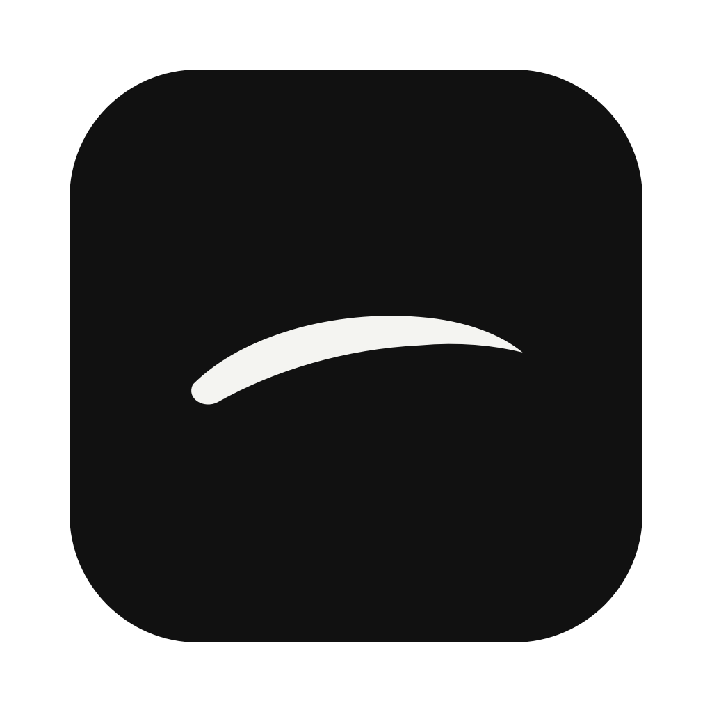
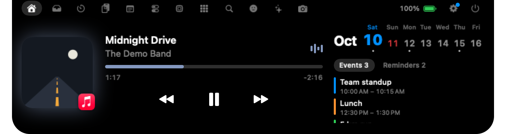

<p align="center"></p>

<h1 align="center">Nunsseop · 눈썹</h1>

<p align="center">
  <b>MacBook 노치, 이제 쓸모 있게.</b><br>
  음악, 통화, 파일, Spotlight 같은 검색, AI 사용량, 에이전트 알림, 일정, 시스템 HUD가 마우스만 올리면 열립니다.
</p>

<p align="center">
  <a href="https://github.com/namekun/Nunsseop/releases/latest"></a>
  
  <a href="LICENSE"></a>
  
</p>

<p align="center">
  <a href="README.md">English</a> · <b>한국어</b> · <a href="README.ja.md">日本語</a> · <a href="README.zh-Hans.md">简体中文</a> · <a href="README.es.md">Español</a> · <a href="README.de.md">Deutsch</a> · <a href="README.fr.md">Français</a> · <a href="https://namekun.github.io/Nunsseop/">홈페이지</a>
</p>

<p align="center">
  
</p>

화면 위의 작은 아치, 노치를 눈썹이라고 불러 봤습니다. 무료 오픈소스이고, 계정·구독·추적이 없습니다.

## 30초 만에 설치

**[Nunsseop.dmg 다운로드](https://github.com/namekun/Nunsseop/releases/latest/download/Nunsseop.dmg)** 후 파일을 열고 Nunsseop을 응용 프로그램으로 끌어다 놓으세요. Apple의 서명과 공증을 받은 앱이라 바로 열립니다. 새 버전이 나오면 설정 → 일반 → 업데이트의 '업데이트 설치'가 새로운 점을 보여 주고, 설치한 뒤 Nunsseop을 다시 시작해요(0.38.0보다 오래된 앱은 새 DMG를 한 번 더 받아야 해요).

[Homebrew](https://brew.sh)로 설치할 수도 있습니다:

```sh
brew install --cask namekun/tap/nunsseop
```

업데이트는 `brew update && brew upgrade --cask nunsseop`으로 하세요. 새 버전이 나오면 설정 → 일반 → 업데이트에서 이 명령을 클립보드에 복사해 줍니다.

macOS 14 Sonoma 이상이면 됩니다. Apple 실리콘 Mac에서 동작하며(Intel 제외), 노치가 없는 화면에서도 동작합니다.

## 처음 1분

1. **노치에 마우스를 올려 보세요.** 열립니다. 마우스를 떼면 다시 접혀요.
2. **음악을 틀어 보세요.** Music, Spotify, YouTube Music, 어떤 브라우저든 노치가 알아챕니다. 접힌 노치에는 작은 앨범아트와 이퀄라이저가 남습니다.
3. **노치를 우클릭 → 설정**에서 탭과 순서, 받을 알림, 크기를 고르세요.

Dock 아이콘은 없습니다. Nunsseop은 노치에 삽니다.

처음 설치하면 노치가 1초쯤 뒤 저절로 열리면서 짧은 안내 네 단계가 이어집니다. 노치가 열리고 닫히는 방법, 탭, 파일 끌어놓기와 검색, 이 Mac에서 찾은 에이전트 도구 연결입니다(찾은 도구가 없으면 「준비됐어요」로 끝납니다). 「건너뛰기」, Esc, 「완료」로 끝낼 수 있고, 설정 → 일반 → 「시작 안내 다시 보기」로 다시 볼 수 있습니다. 업데이트한 뒤에는 처음 한 번 열려 그 버전에서 바뀐 점을 알려 주고, 그다음엔 조용히 빠집니다.

## 둘러보기

| | |
| :---: | :---: |
| <br>**검색.** 앱, 파일, 명령, 클립보드, 이모지, 계산을 한 곳에서. 단축키는 원하는 대로. | <br>**AI 사용량.** Claude Code와 Codex 한도. 로그인 필요 없음. |
| <br>**선반.** 파일을 노치에 놓아 두거나 AirDrop으로 바로 보내기. | <br>**타이머.** 카운트다운, 뽀모도로, 스톱워치. 길이는 원하는 대로. |
| <br>**도구.** 오디오 출력, 마이크 음소거, 잠자기 방지, 화면 녹화, 색 찍기, 글자 복사. | <br>**시스템.** CPU, 메모리, 디스크, 네트워크, 기기 배터리. |
| <br>**이모지.** 왼쪽에 카테고리, 모든 이모지 검색, 클릭 한 번으로 복사. | <br>**HUD.** 볼륨, 밝기, AirPods 배터리 등. |
| <br>**통화.** 통화 중인 앱과 통화 시간. | <br>**한눈에.** 닫힌 노치 양쪽에 보일 것을 직접 고르기. |

## 할 수 있는 것

**🎵 음악**
- **어떤 앱이든 지금 재생 중.** Music, Spotify, YouTube Music, 그리고 Safari, Chrome, Arc, Dia, Aside 같은 브라우저까지. 앨범아트, 컨트롤, 끌어서 옮기는 진행바.
- **실시간 가사.** [LRCLIB](https://lrclib.net)에서 가져와 제목 아래에, 원하면 작업 중에도 노치 아래에 띄웁니다.
- **미리보기.** 곡이 바뀌면 제목이 잠깐 나왔다 사라집니다.
- **팟캐스트와 긴 영상**에서는 15초 건너뛰기와 재생 속도 버튼(1×~2×)이 나타납니다. 플레이어가 지원할 때만 보여요.

**🗂️ 일 처리**
- **선반.** 파일을 노치에 끌어다 두고 나중에 꺼내세요. 이미지·PDF·영상은 선반 높이에 맞춰 커지는 미리보기로 보입니다. 스크린샷과 다 받은 파일이 알아서 들어오게 할 수도 있고, 파일을 끌면서 마우스를 흔들면 커서 옆에 작은 선반이 바로 뜹니다.
- **캘린더와 미리 알림.** 크게 보이는 오늘 날짜, 일정 있는 날에 점이 찍힌 이번 주, 오늘 일정, 노치에서 바로 완료하는 미리 알림. macOS에 추가한 계정(Google, iCloud, Exchange 등)이 모두 되고, 보일 캘린더를 고를 수 있습니다.
- **다가오는 일정.** 시간이 정해진 일정이 시작하기 5분 전에 노치가 제목과 남은 시간을 알려 줍니다. Zoom, Google Meet, Teams, Webex, FaceTime, Whereby, Chime 링크가 있는 일정에는 홈 탭에 초록색 참가 버튼이 붙고, 알림을 누르면 바로 회의에 들어갑니다.
- **Spotlight를 대신하는 검색.** 앱(응용 프로그램 폴더 밖에 있는 앱까지), 파일, 시스템 명령과 설정, 클립보드 기록, 이모지(`:`로 시작), `12*(3+4)` 같은 계산을 자주 연 순서로 보여 줍니다. 머리글자도 됩니다. `vsc`라고 치면 Visual Studio Code가 나와요. 화살표로 고르고 Return으로 엽니다.
- **내 단축키.** 검색은 기본으로 <kbd>⇧⌘Space</kbd>로 열리고, 원하는 키 조합으로 바꿀 수 있습니다. 설정 › 일반 › 단축키에는 비어 있는 동작도 있습니다. 가장 오래 기다린 에이전트로 가기(그 터미널이 앞으로 나옵니다), 에이전트 탭 열기, 마지막 알림이 온 곳으로 가기, 노치 열고 닫기입니다. 다른 동작이 이미 쓰는 조합은 저장되지 않고, macOS나 다른 앱이 이미 쓰는 조합이면 알려 줍니다.
- **타이머, 클립보드 기록, 메모, 이모지 선택기.** 클립보드 기록은 메모리에만 두고, 암호 관리자가 비밀로 표시한 항목은 건너뜁니다. 복사한 링크에서 `utm_`, `fbclid` 같은 추적 파라미터는 지워 줍니다.
- **목록 옆의 상세 보기.** 선반, 클립보드, 앱, 검색, 알림 탭은 포인터 아래의 항목(또는 ↑ ↓로 고른 항목)을 오른쪽에 동작과 함께 보여 줍니다. 행을 클릭하면 지금처럼 바로 복사하거나 열거나 원래 위치로 이동합니다.

**💻 내 Mac**
- **시스템 HUD.** 볼륨, 밝기(DDC 외부 모니터 포함), 키보드 백라이트, 충전, Caps Lock, AirPods 배터리를 노치에 보여 줍니다. 볼륨·밝기 키를 맡아서 시스템 HUD가 뜨지 않게 할 수도 있어요.
- **시스템 상태와 배터리.** CPU, 메모리, 디스크, 네트워크, 이 Mac의 배터리를 패널로 보여 주고, 마우스·키보드·트랙패드 배터리도 함께. 부족하면 알려 줍니다.
- **카메라·마이크 표시.** 어떤 앱이든 쓰는 동안 노치에 표시가 뜹니다.
- **도구.** 오디오 출력 전환, 앱별 볼륨(실험 기능, macOS 14.2 이상), 마이크 음소거, 잠자기 방지, 화면 녹화, 드라이브 꺼내기, 화면 어디서든 색 찍기, 화면 일부의 글자 복사.
- **날씨, 다운로드, 미러, Dock 앱**도 마우스만 올리면. 날씨는 홈 맨 아래 줄에 나옵니다.

**📞 닫혀 있어도**
- **통화.** Zoom, FaceTime, Teams, Slack, Discord, WhatsApp, Google Meet으로 통화하는 동안 닫힌 노치에 통화 앱과 통화 시간이 보입니다. 어떤 앱이 마이크를 쓰는지로 알아내므로 데스크탑 앱의 통화를 보여 주는 데는 권한이 필요 없고, 브라우저의 통화(Meet, 웹의 Zoom·Teams)는 그 브라우저에 대한 자동화 권한이 필요합니다. Zoom, FaceTime, Meet은 통화 앱으로 넘어가지 않고 노치에서 마이크를 음소거할 수 있고(카메라 끄기는 Zoom과 Meet), Zoom과 FaceTime은 손쉬운 사용 권한이, Meet은 Chromium 기반 브라우저의 *Apple Events의 JavaScript 허용*이 필요합니다.
- **양쪽에 원하는 것.** 아무것도 재생하지 않을 때 Claude Code·Codex 남은 사용량, 작업 중인 에이전트, 배터리, 날씨, 날짜를 띄워 두세요.
- **음악과 타이머.** 음악이 나오는 동안 작은 앨범아트와 이퀄라이저, 타이머가 도는 동안 남은 시간. 타이머, 통화, 다운로드는 양쪽 폭을 각각 담긴 내용에 맞추기 때문에, 아이콘 하나뿐인 쪽에 넓은 빈자리가 생기지 않습니다.
- **다운로드.** Safari나 Chrome에서 받는 파일이 몇 % 받아졌는지. Finder가 파일 아이콘에 보여 주는 진행률을 그대로 받아 오기 때문에 따로 확인하러 다니지 않습니다.

**🤖 개발자를 위해**
- **AI 사용량.** Claude와 Codex의 한도와 초기화 시각, 최근 5시간·7일 토큰 사용량. Claude Code, Codex, gjc, omo, OpenCode 사용량을 모두 합칩니다. 두 도구가 이 Mac에 이미 남기는 파일을 읽으므로 로그인할 게 없습니다. 한도가 70%에 이르면 주황색과 "!"로 바뀝니다.
- **Claude Code에서 가져오는 Claude 한도.** 설정 → 서비스 → AI 사용량에서 Claude Code의 상태 표시줄을 연결하세요. Claude Code가 답할 때마다 5시간·주간 한도를 넘겨 주므로, 작업하는 동안 AI 탭이 계속 최신으로 유지되고 Nunsseop이 Anthropic에 따로 묻지도 않습니다. 원래 쓰던 상태 표시줄은 그대로 보이고, 연결 해제를 누르면 원래대로 돌아갑니다. 이전에 쓰던 명령을 되살릴 수 없으면 설정에서 알려 줍니다.
- **Claude 실시간 한도 (선택).** Claude를 다른 곳에서 쓴다면, AI 탭이 Anthropic에서 Claude의 5시간·주간 한도를 받아올지 한 번 묻습니다. 켜면 Claude Code가 키체인에 둔 로그인 정보로 한 시간에 한 번쯤 받아옵니다. 이 로그인은 Claude Code가 실행될 때 새로 고쳐지므로, 한동안 쓰지 않았다면 AI 탭은 다시 로그인하라는 대신 Claude Code를 실행하라고 알려 줍니다. 허락하기 전에는 꺼져 있고, 나중에 설정 → 서비스에서 바꿀 수 있습니다. 가장 최근 값이 우선하고, 그 값에 요금제와 모델별 막대가 없으면 이전 것을 그대로 보여 줍니다.
- **한도 알림.** Claude나 Codex의 5시간·주간 한도가 80%, 95%를 넘을 때 한 번씩 알려 주고, 그만큼 쓴 한도가 초기화되면 다시 쓸 수 있다고 알려 줍니다. 기본으로 켜져 있고, 설정 → 알림 → AI 사용량에서 끌 수 있습니다.
- **에이전트와 터미널 알림.** Claude Code, Codex, Gemini CLI, GitHub Copilot, Antigravity, Cursor, OpenCode 훅, omp·omo·pi 확장, Hermes·Amp 플러그인, Muxy 2·cmux·herdr·Paseo 안의 에이전트, tmux와 WezTerm의 벨이 노치에 뜹니다. 알림을 누르면 그 터미널, 창, 탭이 앞으로 나옵니다([설정 방법](#에이전트와-터미널-알림)).
- **권한 요청과 질문.** Claude Code가 실행이나 편집을 물으면 노치에서 바로 허용, 거부, 항상 허용할 수 있습니다. 항상 허용은 Claude Code가 제안한 규칙이 일반 키보드 문자(출력 가능한 ASCII)만으로 카드에 들어갈 때만 나타납니다. 카드에는 도구, 폴더, 모든 항목이 보이고, 텍스트에 영문자나 기호로 보일 수 있는 문자가 있으면 주황색 「확인 필요한 문자」 칩으로 알립니다. Codex의 명령, 파일 편집(`apply_patch`는 파일 목록이 보입니다), MCP 도구 승인도 같은 방식이며, 항상 허용 대신 「터미널에서 답하기」가 나옵니다. OpenCode의 권한 요청도 같은 방식이고, Paseo의 도구 승인도 같지만 「터미널에서 답하기」 대신 「Paseo에서 답하기」가 나옵니다. GitHub Copilot, Antigravity(명령과 파일 쓰기), Cursor(셸 명령과 MCP 호출)의 승인도 같은 방식이며, Cursor는 「Cursor에서 답하기」가 나옵니다. 실행될 내용이 조금이라도 불분명한 요청(예를 들어 샌드박스 밖에서 도는 Cursor 셸 명령)에는 카드가 뜨지 않고 도구가 자기 프롬프트로 묻습니다. Gemini CLI, Hermes, Amp는 세션과 알림만 보여 주고 승인은 다루지 않습니다. Claude Code의 질문에도 답할 수 있습니다. 답을 하나 또는 여러 개 고르고, 질문이 여러 개면 차례로 넘기며, 「터미널에서 답하기」로 터미널에 돌려줄 수도 있습니다. 답을 그대로 보여 줄 수 없는 질문은 터미널에 남습니다. 터미널에서 먼저 답하면 카드는 사라집니다. 요청 내용은 메모리에만 남습니다(설정 → 알림에서 끌 수 있습니다).
- **알림 탭.** 에이전트, 터미널, 캘린더에서 온 최근 알림 30개를 모아 두고, 아직 안 본 개수를 배지로 보여 줍니다. 누르면 알림이 온 곳으로 돌아갑니다. 기본으로는 꺼져 있고(설정 → 노치 구성), 메모리에만 둡니다.
- **눈썹 표정.** 눈썹이 에이전트 상태를 표정으로 보여 줍니다. 나를 기다리는 에이전트가 있으면 꼬리를 치켜들고, 일하는 중이면 낮고 평평해집니다. 에이전트가 턴을 마치면 눈썹이 두 번 들썩이고, 노치가 어느 에이전트가 끝났는지 알려 줍니다(그 터미널이 이미 앞에 있으면 알리지 않음, 설정 › 알림). Claude나 Codex 한도가 얼마 안 남으면 축 처지고, 한도가 초기화되면 다시 올라갑니다. 노치가 없는 화면에서는 앱의 눈썹이 직접 표정을 짓고, 노치가 있는 화면에서는 에이전트 수 옆에 작은 눈썹이 나오며, 에이전트·한도 알림의 아이콘도 눈썹입니다. 동작 줄이기를 켜 두면 움직이지 않습니다.
- **작업 중인 에이전트.** 닫힌 노치에 나를 기다리는 코딩 에이전트 수(치켜뜬 눈썹, 노란 숫자)를 보여 주고, 기다리는 에이전트가 없으면 일하는 에이전트 수(낮고 평평한 눈썹, 초록 숫자)를 보여 줍니다. Claude Code, Codex, Gemini CLI, OpenCode, GitHub Copilot, Antigravity, Cursor, Hermes, Amp, omp, omo, pi는 훅, 플러그인, 확장으로 따라가고(설정 → 알림에서 연결, Codex는 다음에 시작할 때 훅을 신뢰할지 묻습니다), gjc, herdr, Muxy 2, Paseo는 연결 없이 따라가며, `claude --bg`로 띄운 백그라운드 세션도 셉니다. Claude Code가 턴을 마칠 때 서브에이전트나 백그라운드 셸 명령이 아직 돌고 있으면, 그 세션은 최대 두 시간까지 계속 작업 중으로 세고 에이전트 탭에 「백그라운드 · 작업 N개」 칩이 붙습니다.
- **에이전트 탭.** 작업 중이거나 나를 기다리는 코딩 에이전트 세션을 한 줄에 하나씩 나열합니다. Claude Code, Codex, Gemini CLI, OpenCode, GitHub Copilot, Antigravity, Cursor, Hermes, Amp, omp, omo, pi, gjc, Paseo와 herdr, Muxy 2 안에서 도는 에이전트가 대상입니다. 상태는 색뿐 아니라 모양도 다릅니다. 나를 기다리면 속이 찬 주황 점, 일하는 중이면 도는 초록 호, 쉬는 중이면 빈 고리입니다. 이어서 이름(Claude Code의 `/rename` 이름이나 자체 제목, Codex의 스레드 이름), 폴더, 도구와 모델, 기본값이 아닌 권한 모드 칩, 토큰 수가 붙은 작은 컨텍스트 막대, 그 상태가 된 뒤 흐른 시간이 보입니다. 모든 줄에 「터미널로」(Paseo 줄은 「Paseo에서 열기」)와 「메시지」 버튼이 있고, 점선 버튼은 지금은 쓸 수 없다는 뜻이며 툴팁이 이유를 알려 줍니다. 나를 기다리는 세션은 줄이 펼쳐지며 「터미널에서 답하기」가 나옵니다. 맨 아래 줄은 상태별 개수를 요약합니다(「1개 대기 · 3개 작업 중 · 1개 쉬는 중」). 키보드는 ↑↓로 선택, ↵로 터미널 이동, ⌘M으로 메시지 입력창 열기이고, 줄을 더블클릭해도 터미널로 갑니다. 최근 3시간 안에 쓴 열린 세션은 흐리게 「쉬는 중」으로 보입니다(닫힌 노치의 수에는 넣지 않습니다). 열린 세션이 하나도 없을 때는 「최근」에 열려 있지 않은 지난 일주일의 대화가 최대 5개 나오고, 누르거나 ↵를 누르면 설정 → 알림에서 고른 터미널에서 이어집니다(`claude --resume`, `codex resume`, 또는 각 도구 고유의 옵션). 이 Mac에 있는 도구의 세션 파일에서 폴더, 모델, 토큰 수, 권한 모드, 세션 이름, 마지막 프롬프트를 읽습니다. 일하는 세션이나 턴을 마친 세션 아래에는 마지막 작업이 나옵니다. 읽거나 고친 파일, 실행한 명령, 물어본 질문입니다. 수정이면 +N −M과 **diff 보기**가 붙고, 누르면 목록 자리에 바뀐 줄이 나옵니다(← →로 이번 턴의 다른 수정, Esc로 돌아가기). 탭에 일하는 세션이 보이는 동안은 세션 파일을 2초마다 확인합니다.
- **세션에 메시지 보내기, 파일 끌어놓기.** 줄의 「메시지」 버튼(또는 ⌘M)을 누르면 맨 아래 줄이 그 세션 이름이 붙은 「받는 사람」 입력창으로 바뀌고, Return을 누르면 글이 그 세션의 입력으로 들어가 Return까지 전달됩니다. Esc는 취소입니다. 선반이나 Finder의 파일을 줄 위로 끌어다 놓으면 그 경로가 Return 없이 입력되고, 선반에서 끌어올 때는 에이전트 탭 버튼 위에 포인터를 잠시 두면 탭이 바뀝니다. Ghostty, Terminal, iTerm2, WezTerm, kitty, cmux, herdr, Muxy 2, Orca의 세션에서 되고(Terminal은 메시지만 받고 파일은 받지 않습니다), Paseo는 일하는 중이 아닌 에이전트에 메시지만 됩니다(아래 「어디서 무엇이 되나요」 표). 권한 요청이나 질문이 열려 있을 수 있는 동안, tmux·zellij·screen 안의 세션, 어느 터미널에 있는지 확인하지 못한 세션에는 아무것도 보내지 않습니다.
- **주간 요약.** 한 주가 바뀐 뒤(월요일 이후) 처음 노치를 열면 「지난주, 눈썹이 지켜본 것」 카드가 나옵니다. 에이전트가 일한 시간(그 전 주와 비교), 도구별 세션 수, 바뀐 줄(+/−)과 파일 수, 도구별 토큰, 가장 많이 작업한 프로젝트와 그 비중, 가장 긴 세션, 가장 바쁜 날(막대)을 보여 줍니다. Claude Code, Codex, omo, gjc, omp, pi, OpenCode의 세션 파일에서 이 Mac 안에서만 계산하고 어디로도 보내지 않으며, 프로그램이 Agent SDK로 시작한 세션은 뺍니다. **이미지로 저장**은 프로젝트 이름을 가린 1080×1920 PNG를 다운로드 폴더에 저장합니다. AI 사용량 탭의 「지난주」에서 언제든 다시 열 수 있습니다. 기본으로 켜져 있고, 설정 › 알림 › AI 사용량에서 끌 수 있습니다.

**🧩 내게 맞게**
- 탭은 모두 헤더 한 줄에 들어가고, 지금 탭은 캡슐 안에 이름이 표시됩니다. 홈, 타이머, 도구, 시스템, AI 사용량은 큰 숫자와 가는 막대의 패널로 구성됩니다. 설정에는 사이드바가 있고, 노치 구성의 탭 목록은 끌어서 순서를 바꾸는 2열 격자입니다.
- 탭을 고르고 끌어서 순서를 정하고, 헤더에 날짜를 보일지, 접힌 노치에 보일 것, 받을 알림을 고르세요. **꺼 둔 기능은 아예 동작하지 않습니다.**
- macOS 26에서는 펼친 노치와 카드가 Liquid Glass로 그려져 뒤 화면이 은은하게 비칩니다. 유리의 농도를 조절할 수 있고, 100%로 올리면 완전히 검은 노치가 됩니다. 유리를 아예 끌 수도 있습니다.
- 노치가 없는 화면에서는 닫힌 노치가 메뉴 막대 안의 작은 알약이 되고, 그 위에 흰 붓 자국 모양의 눈썹이 얹힙니다. 원하면 유리로도 그려집니다. 마우스를 올리면 눈썹이 치켜올라갑니다. 한동안 쓰지 않으면(3~60초, 또는 끄기) 눈 감듯 눈썹이 내려앉으며 사라지고, 마우스가 닿으면 다시 나타나며, 0.5초쯤 머무르면 화면 위 가장자리에 붙어 열립니다. 이런 화면에서는 HUD, 알림, 가사, 미리보기가 한 줄로 표시되고, 기호가 레벨 막대, 퍼센트, 텍스트 바로 옆에 붙습니다. 평소 표시는 알약을 양쪽 각각 그 값만큼만 늘리고, 값은 눈썹 바로 옆에 놓이며, 눈썹은 카메라 위에 그대로 있습니다.
- 표시할 화면, 크기, 열리는 지연 시간, 로그인 시 실행, 덮개를 닫았을 때 숨기기도 고를 수 있습니다. 화면을 자동으로 두면 닫힌 노치가 포인터를 따라 다른 화면으로 옮겨 가고, 끄면 한 화면에 머뭅니다. Mission Control을 열면 숨습니다.
- 아래로 쓸면 열기, 위로 쓸면 닫기, 홈 탭에서 옆으로 쓸면 다음 곡.
- English, 한국어, 日本語, 简体中文, Español, Deutsch, Français. Mac 언어 설정을 따릅니다.

## 자주 묻는 질문

<details>
<summary><b>"Nunsseop을 열 수 없습니다"라고 나와요.</b></summary>

0.37.0부터는 Apple의 서명과 공증을 받아 다른 앱처럼 열립니다. 그보다 오래된 버전은 공증 전이라 그렇습니다. [최신 DMG](https://github.com/namekun/Nunsseop/releases/latest/download/Nunsseop.dmg)를 다시 받거나 Homebrew로 업데이트(`brew update && brew upgrade --cask nunsseop`)하세요.
</details>

<details>
<summary><b>음악을 틀어도 아무것도 안 나와요.</b></summary>

Nunsseop은 macOS가 '지금 재생 중'으로 아는 것을 보여 줍니다. 제어 센터에 재생 정보가 뜨는 앱이어야 하는데, 대부분의 앱과 브라우저가 그렇습니다. 막혔을 때의 대체 경로는 [재생 정보를 읽는 방법](#재생-정보를-읽는-방법)을 보세요.
</details>

<details>
<summary><b>Spotlight 대신 쓸 수 있나요?</b></summary>

네. 설정 → 일반에서 단축키를 누르고 <kbd>⌘Space</kbd>를 누르세요. Spotlight가 쓰고 있다고 알려 주면서 키보드 단축키를 열어 주는데, 거기서 *Spotlight 검색 보기*를 끄면 됩니다. 검색 탭을 숨겨 둬도 단축키로 열립니다.
</details>

<details>
<summary><b>탭이 너무 많아요.</b></summary>

노치를 우클릭 → 설정 → 노치에서 필요 없는 탭을 끄세요. 꺼 둔 기능은 아예 동작하지 않습니다.
</details>

<details>
<summary><b>노치가 없는 Mac이에요.</b></summary>

덮개를 닫고 쓰는 외장 모니터처럼 노치가 없는 화면에서는, 닫힌 노치가 메뉴 막대 안에 떠 있는 작은 알약으로 나타나고, 그 위에 흰 붓 자국 모양의 눈썹이 얹힙니다. 마우스를 올리면 눈썹이 치켜올라가고, 열면 화면 위 가장자리에 평소 크기의 노치로 붙습니다. HUD, 알림, 가사, 미리보기는 카메라를 둘러싸지 않고 한 줄로 표시됩니다. 쓰지 않으면 눈 감듯 눈썹이 내려앉고 알약이 사라지는데, 끄거나 시간을 바꾸는 건 설정에서 할 수 있습니다. 화면이 여러 개면 닫힌 노치는 포인터가 있는 화면으로 옮겨 다닙니다. 다 닫힌 뒤에 옮겨 가고, HUD와 승인 요청, 미리보기도 그 화면에 뜹니다. 한 화면에 붙박아 두려면 설정에서 그 화면을 고르세요.
</details>

<details>
<summary><b>AI 사용량의 Claude 한도가 오래된 값이에요.</b></summary>

기본으로는 Claude의 5시간·주간 %를 다른 도구가 남기는 캐시에서 읽습니다. 터미널에서 Claude Code를 쓸 때 [oh-my-claudecode](https://github.com/Yeachan-Heo/oh-my-claudecode) HUD가 저장하는 캐시나 gjc의 캐시입니다. 카드에 마지막 갱신 시각이 함께 나옵니다. 최신 값을 보려면 설정 → 서비스 → AI 사용량에서 Claude Code의 상태 표시줄을 연결하세요. Claude Code가 답할 때마다 한도를 넘겨 주고, 원래 쓰던 상태 표시줄도 계속 동작합니다. Claude를 다른 곳에서 쓴다면 대신 AI 탭이나 설정 → 서비스에서 Claude 실시간 한도를 켜세요. 가장 최근 값이 우선하고, 그 값에 요금제와 모델별 막대가 없으면 이전 것을 그대로 보여 줍니다. 토큰 사용량은 항상 실시간입니다.
</details>

<details>
<summary><b>업데이트 후 볼륨 키를 눌러도 Nunsseop HUD가 안 떠요.</b></summary>

0.8.3 이전 버전은 서명 방식 때문에 업데이트할 때마다 macOS가 손쉬운 사용 권한을 잊었습니다. 0.8.3부터는 유지됩니다. 이전 버전에서 올라왔다면 시스템 설정 → 개인정보 보호 및 보안 → 손쉬운 사용에서 Nunsseop을 한 번 지웠다가 다시 허용하세요. 다시 실행하지 않아도 바로 적용됩니다.
</details>

## 사용자 지정 알람

**설정 → 알람 → +**에서 시간과 문구를 등록하세요. 매일, 선택한 요일, 특정 날짜 1회 중에서 일정을 고르고, 알람마다 켜기·끄기와 소리를 설정할 수 있습니다.

예약 시각이 되면 화면 오른쪽 위에 팝업이 10초 동안 표시됩니다. **확인**을 누르지 않으면 설정한 간격(기본 1분, 1~1,440분)으로 계속 표시됩니다. 여러 알람이 겹치면 하나씩 순서대로 표시하며, 같은 알람의 팝업은 쌓이지 않습니다. 팝업이 사라져도 설정 → 알람에서 **확인 · 반복 종료**를 누를 수 있습니다.

확인은 이번 회차의 반복만 종료합니다. 매일·요일별 알람은 다음 예약에 다시 울리고, 1회 알람은 확인 후 꺼집니다. 문구는 최대 100자이며 비워 두면 **눈썹 알림**으로 표시됩니다. 입력 화면의 미리보기에서 실제 팝업에 표시되는 내용을 확인할 수 있습니다.

설정과 미확인 상태는 이 Mac에 저장됩니다. 앱이 꺼져 있거나 Mac이 잠든 동안에는 팝업을 띄울 수 없으며, 앱을 실행하거나 잠자기에서 깨어나면 놓친 알람을 한 번 표시하고 그 시점부터 반복합니다. 알람을 끄거나 삭제하면 진행 중인 반복도 종료되며, 수정 후 저장하면 기존 반복을 종료하고 새 일정으로 예약합니다. 시간은 Mac의 현지 시간을 따릅니다.

## 에이전트와 터미널 알림

Nunsseop은 이 Mac 안(`127.0.0.1:47750`)에서만 다른 도구의 알림을 받습니다. 요청에는 `~/Library/Application Support/Nunsseop/notify-token`에 저장된 비밀 토큰이 있어야 합니다.

설정 → 알림에서 Claude Code, Codex, Gemini CLI, GitHub Copilot, Antigravity, Cursor, OpenCode, Hermes, Amp, omp, omo, pi 옆의 **연결**을 누르세요. 이 Mac에서 써 본 도구만 보입니다. Nunsseop이 그 도구의 설정 파일(`~/.claude/settings.json`, `~/.codex/config.toml`, `~/.codex/hooks.json`, `~/.gemini/settings.json`)을 바꾸거나 `~/.config/opencode/plugins`에 플러그인을, `~/.omp/agent/extensions`에 작은 확장을 추가하고(omo와 pi는 `~/.omo`, `~/.pi`), 기존 파일은 `.nunsseop-backup` 확장자로 남겨 둡니다. 아무것도 쓰기 전에 시트가 파일이 어떻게 바뀌는지(추가되는 줄은 초록, 빠지는 줄은 빨강, 그대로인 구간은 접어서)와 어느 백업이 남는지 보여 줍니다. **취소**하면 아무것도 쓰지 않습니다. 파일을 다른 도구와 함께 쓰는 경우(Claude Code, Codex, Gemini CLI, Antigravity, Cursor)에는 이미 있던 훅이 그대로 남고, **연결 해제**하면 Nunsseop의 것만 빠집니다. Codex는 `notify` 명령을 하나만 둘 수 있어서, 이미 있던 명령은 Nunsseop 다음에 그대로 실행됩니다. 작업 중인 에이전트 수를 위한 훅은 다른 도구의 훅 옆에 `~/.codex/hooks.json`으로 들어가며, Codex가 다음에 시작할 때 신뢰할지 묻습니다(“Review hooks”로 Nunsseop의 훅만 신뢰할 수 있고, “Trust all and continue”는 모든 도구의 새 훅을 신뢰합니다). 그 전에는 실행되지 않고, 훅 문구가 바뀌는 업데이트 뒤에는 다시 묻습니다. 노치에서 승인에 답하기 위한 훅도 같은 방식으로 신뢰해야 하며, 전에 연결했다면 Codex가 한 번 더 물으니 /hooks에서 검토하세요. **연결 해제**를 누르면 원래대로 돌아갑니다. 그 뒤에 시작한 세션의 알림이 노치에 뜹니다. gjc는 연결할 필요가 없습니다. 에이전트 수나 에이전트 탭이 보이는 동안 gjc 자체 파일에서 세션을 읽습니다.

GitHub Copilot은 전용 훅 파일 `~/.copilot/hooks/nunsseop.json`을 받고, Antigravity(`agy` 명령줄)는 `~/.gemini/config/hooks.json`에 항목 하나를, Cursor는 `~/.cursor/hooks.json`에 항목 몇 개를 다른 도구의 훅 옆에 받습니다. Hermes와 Amp는 Nunsseop의 플러그인(`~/.hermes/plugins/nunsseop`, `~/.config/amp/plugins/nunsseop.ts`)을 받습니다. Hermes는 터미널에서 `hermes plugins enable nunsseop`을 한 번 실행해야 플러그인을 불러오며, 설정에 그 명령과 Hermes에서 켜졌는지가 표시됩니다. Amp의 플러그인 API는 실험 단계라서, Amp 업데이트 후 작동하지 않을 수 있습니다. 연결하고 나면 Gemini CLI, GitHub Copilot, Antigravity, Cursor, Hermes, Amp가 세션을 에이전트 수와 에이전트 탭에 알리고, 턴이 끝나면 알림을 보냅니다. GitHub Copilot, Antigravity, Cursor의 승인은 설정 › 알림의 「권한 요청과 질문에 노치에서 답하기」가 켜져 있을 때만 노치에 뜹니다.

Claude Code를 직접 설정하려면 **Claude Code 훅 명령 복사**를 누르고 `~/.claude/settings.json`에 넣으세요.

```json
{
  "hooks": {
    "Notification": [
      { "hooks": [{ "type": "command", "command": "<복사한 명령을 여기에 붙여 넣기>" }] }
    ]
  }
}
```

터미널과 에이전트 앱은 훅 없이 됩니다.

- **Muxy 2:** Muxy가 직접 감지한 에이전트를 Muxy가 실행되는 동안 `muxy activity list`로 읽습니다. 알림으로 뜨고(Muxy가 앞에 있을 때는 띄우지 않습니다), Muxy만 아는 세션은 일하거나 기다리는 동안에만 에이전트 탭에 나옵니다. 알림 파일과 소켓을 쓰던 Muxy 1은 지원하지 않습니다.
- **cmux:** 앱에 들어 있는 cmux 명령으로 알림을 읽어 옵니다. cmux가 앞에 있을 때는 띄우지 않습니다.
- **herdr:** 모든 세션에서 작업을 마쳤거나 입력을 기다리는 에이전트를 herdr 소켓에서 읽습니다.
- **Paseo:** 작업을 마쳤거나 실패한 에이전트를 Paseo가 남기는 기록 파일에서 읽으므로 데몬 없이도 뜹니다. 승인 카드와 Paseo의 이벤트에는 이 Mac에서 비밀번호 없이 실행되는 데몬이 필요하며, 데몬은 Nunsseop이 직접 켜지 않습니다.
- **tmux:** 어느 창의 벨이든 보여 줍니다. 실행 중인 tmux 서버에만 훅을 추가하고 `tmux.conf`는 바꾸지 않습니다.
- **WezTerm:** 설정 → 알림에서 복사한 줄을 `~/.wezterm.lua`에 붙여 넣으면 벨이 뜹니다.

각각 설정 → 알림에 스위치가 있고(WezTerm은 대신 설정 줄을 복사하는 버튼이 있습니다), 그 도구가 설치돼 있을 때만 보입니다. 자체 훅으로 이미 연결된 도구는 두 번 뜨지 않습니다. Orca는 자체 알림 소스가 없어서, 위에서 연결한 훅과 확장(Claude Code, Codex, OpenCode, pi 등)이 Orca 창 ID를 함께 보낼 때만 세션이 나타납니다.

어떤 스크립트든 같은 방식으로 보낼 수 있습니다.

```sh
# notify-auth에 Authorization 헤더가 들어 있어서, 토큰이 프로세스 목록에 보이지 않습니다.
curl -X POST http://127.0.0.1:47750/notify \
  -H @"$HOME/Library/Application Support/Nunsseop/notify-auth" \
  -d '{"title": "빌드", "message": "42초 만에 끝났어요"}'
```

### 어디서 무엇이 되나요

에이전트 탭에서 줄의 「터미널로」·「메시지」 버튼과 파일 끌어놓기는, 그 세션이 어느 터미널에 있는지 Nunsseop이 확신할 수 있을 때만 동작합니다. 세션의 프로세스가 정말 그 터미널 안에서 도는지 확인합니다. 글은 터미널 자체의 입력 API로 들어가며, 가짜 키 입력으로 보내지 않습니다. 메시지나 파일 끌어놓기가 안 되는 경우에는 버튼이 점선이 되고 툴팁이 이유를 알려 줍니다(tmux·zellij·screen이 사이에 있음, 답을 기다리는 요청이 있음, 같은 폴더에 Ghostty 탭이 여러 개 있음 등). 이때도 「터미널로」는 터미널 앱을 앞으로 가져옵니다.

| 터미널 | 탭·창으로 이동 | 메시지 | 파일 끌어놓기 | 「최근」에서 이어 열기 |
| --- | :---: | :---: | :---: | :---: |
| Ghostty | ✓¹ | ✓¹ | ✓¹ | ✓ |
| Terminal | ✓ | ✓ | — | ✓ |
| iTerm2 | ✓ | ✓ | ✓ | ✓ |
| WezTerm | ✓ | ✓ | ✓ | ✓ |
| kitty | ✓ | ✓ | ✓ | ✓ |
| cmux | ✓ | ✓ | ✓ | ✓ |
| herdr | ✓ | ✓ | ✓ | — |
| Muxy 2 | ✓ | ✓ | ✓ | ✓ |
| Orca | ✓ | ✓ | ✓ | ✓ |
| Paseo | ✓ | ✓ | — | ✓ |

¹ Claude Code 세션만 해당합니다.

- **Ghostty, Terminal, iTerm2**는 AppleScript로 다루므로, macOS가 Nunsseop이 각각을 제어해도 되는지 한 번씩 묻습니다(시스템 설정 › 개인정보 보호 및 보안 › 자동화). Ghostty는 셸에게 자기 탭이 어느 것인지 알려 주지 않으므로, Nunsseop은 세션의 폴더와 Claude Code가 탭에 붙이는 제목으로 탭을 고릅니다. 그래서 탭 이동, 메시지, 파일 끌어놓기는 Claude Code 세션에서만 되고, 어느 탭인지 확실하지 않으면 아무것도 보내지 않습니다. Terminal은 실행할 글만 받을 수 있어 메시지는 받지만 끌어놓은 파일은 받지 않습니다.
- **WezTerm과 kitty**는 명령줄 도구(`wezterm cli`, `kitty @`)로 다룹니다. kitty는 원격 제어를 켜고 소켓을 열어 두어야 합니다.
- **Muxy 2:** 세션의 정확한 창으로 가고 새 탭에서 대화를 이어 열려면, Nunsseop의 작은 브리지 확장을 한 번 불러와야 합니다. Muxy에서 Settings › Extensions › Load Unpacked…를 열어 `~/Library/Application Support/Nunsseop/muxy-bridge` 폴더를 고르고(설정 → 알림의 「Finder에서 확장 프로그램 보기」가 그 폴더를 열어 줍니다) 확장을 켜세요. 불러오지 않으면 클릭은 세션의 프로젝트만 선택합니다. 훅 없이 Muxy만 아는 세션은 이동만 되고 글은 보내지 않습니다.
- **Orca:** `orca` 명령줄로 다룹니다. 최근 대화는 Orca에 창이 있는 동안 그 대화가 있는 워크트리의 새 탭에서 이어집니다.
- **Paseo:** 메시지는 `paseo send`로 가며, 일하는 에이전트는 끊기게 되므로 일하는 중이 아닌 에이전트(끝난 에이전트와 내 차례를 기다리는 에이전트 포함)에만 보냅니다. 누르면 Paseo에서 그 에이전트가 열리고(표의 첫 칸이 이 동작입니다), 보관된 에이전트는 「최근」에서 되살아납니다.
- **이어 열기**는 설정 → 알림의 「대화를 이어서 열 곳」에서 고른 터미널에서 이루어지고, 안 될 때는 Terminal이 대신합니다. Ghostty, iTerm2, cmux는 설치돼 있으면 목록에 나오고 실행 중이 아니면 먼저 켭니다. WezTerm은 명령줄 도구가 있을 때, kitty는 그 세션이 알려 준 소켓이 아직 있을 때만, Orca는 창이 열려 있고 Orca가 워크트리로 아는 폴더일 때만(아니면 다음 터미널로 넘어갑니다), Muxy는 브리지가 실행 중일 때만 나옵니다. Ghostty와 iTerm2는 자동화로 새 탭을 열고(Ghostty는 권한이 없으면 새 창), cmux는 탭이 아니라 새 워크스페이스를 엽니다. Paseo의 「최근」 항목은 이 설정과 무관하게 Paseo에서 열립니다.

## 권한

권한은 대부분 그 기능을 처음 쓸 때 요청합니다. 예외는 스크린샷(기본은 데스크탑, 또는 스크린샷 폴더로 정한 곳)과 다운로드를 지켜보는 폴더로, Nunsseop이 처음 시작할 때 macOS가 물을 수 있습니다.

| 기능 | 권한 | 요청 시점 |
| --- | --- | --- |
| 캘린더 | 캘린더 | 홈 탭에서 *접근 허용*을 누를 때 |
| 미리 알림 | 미리 알림 | 홈 탭에서 *미리 알림 허용*을 누를 때 |
| 미러 | 카메라 | 미러 탭에서 *카메라 허용*을 누를 때 |
| 화면 녹화, 다른 앱 창의 글자 복사 | 화면 기록 | 처음 녹화하거나 글자를 복사할 때 |
| 소리와 함께 녹화 | 마이크 | 마이크 녹음을 켜고 처음 녹화할 때 |
| 볼륨·밝기·키보드 백라이트 키 대체 | 손쉬운 사용 | 설정에서 그 옵션을 켤 때 |
| Music·Spotify·브라우저 대체 재생 정보 | 자동화 | MediaRemote 헬퍼를 쓸 수 없을 때만 |
| 브라우저의 Google Meet·Zoom·Teams 통화 표시, Meet의 마이크·카메라 버튼 | 자동화(해당 브라우저) | 브라우저가 처음 마이크를 쓸 때 |
| 선반에 새 스크린샷 추가, 다운로드 알림 | 데스크탑·다운로드 폴더 | Nunsseop이 처음 시작할 때 macOS가 물을 수 있습니다(스크린샷 폴더(기본은 데스크탑)와 다운로드 폴더를 지켜봅니다) |
| 앱별 볼륨 | 시스템 오디오 녹음 | 도구 탭에서 처음 앱 볼륨을 줄일 때 |
| Zoom·FaceTime 통화의 마이크 버튼, Zoom의 카메라 버튼 | 손쉬운 사용 | 스스로 요청하지는 않습니다. Nunsseop이 손쉬운 사용에서 허용돼 있으면 버튼이 나타납니다(위의 볼륨 키 옵션으로 허용할 수도 있습니다) |
| 에이전트 세션에 메시지 입력, 세션의 탭으로 이동, 새 탭에서 대화 이어 열기(iTerm2와 Ghostty만) | 자동화(Terminal, iTerm2, Ghostty) | 그 앱에서 처음 할 때. Ghostty는 에이전트 탭에 Ghostty 안의 세션이 처음 나타날 때도 |
| 로그인 시 실행 | 로그인 항목 | 설정에서 켤 때 |

## 개인정보

Nunsseop은 개인 정보를 수집하거나 보내지 않습니다. 인터넷은 아래 경우에만 씁니다.

- 하루 한 번 `api.github.com`에서 새 버전 확인 (끌 수 있음). DMG로 설치한 앱에서 업데이트를 설치할 때는 GitHub에서 최신 릴리스의 `appcast.xml`과 DMG를 받음
- `lrclib.net`에서 실시간 가사 찾기 (끌 수 있음)
- 입력한 도시의 날씨를 `open-meteo.com`에서 가져오기 (도시를 입력하기 전에는 꺼져 있음). Open-Meteo가 도시를 못 찾으면 Apple 지오코더에 위치를 물어봅니다
- MediaRemote 헬퍼를 쓸 수 없을 때만, 알려진 음악 서비스에서 HTTPS로 앨범아트 받기
- Claude 실시간 한도를 켰을 때만, 키체인에 있는 Claude Code 로그인 정보로 한 시간에 한 번쯤 `api.anthropic.com`에 Claude 한도 묻기

나머지는 모두 이 Mac 안에서만 처리됩니다. 알림 서버는 이 Mac에서 오는 연결만 받고, AI 사용량은 Claude 실시간 한도를 켜지 않는 한 Claude Code 상태 표시줄이 이 Mac에 남기는 한도를 포함해 로컬 파일에서 읽고, 알림 탭의 알림은 메모리에만 두고, 녹화 파일은 스크린샷 옆에 저장됩니다. 카메라 미리보기는 미러 탭이 열려 있을 때만 켜지고 녹화되지 않습니다. 클립보드 기록은 Nunsseop을 끄면 지워집니다.

## 재생 정보를 읽는 방법

macOS 15.4부터 비공개 MediaRemote 프레임워크는 Apple이 서명한 프로세스에만 응답합니다. Nunsseop은 작은 헬퍼 라이브러리(`Sources/NowPlayingHelper`)를 시스템의 `/usr/bin/perl` 안에서 실행해 재생 정보를 읽고, 재생·일시정지·건너뛰기·위치 이동 명령을 보내고, 결과를 JSON 줄로 앱에 넘깁니다.

비공개 API에 기대는 방식이라 이후 macOS 업데이트로 막힐 수 있습니다. 그러면 Music과 Spotify는 AppleScript로, 브라우저는 미디어 탭을 읽는 방식으로 바뀝니다. 이 대체 경로는 브라우저마다 *Apple Events의 JavaScript 허용*을 켜야 합니다. Dia에는 그 메뉴가 없어서, Nunsseop이 `--enable-applescript-javascript` 옵션으로 Dia를 다시 열어 줍니다.

## 소스에서 빌드

```sh
git clone https://github.com/namekun/Nunsseop.git
cd Nunsseop
./scripts/bundle.sh release      # build/Nunsseop.app
./scripts/make-dmg.sh            # build/Nunsseop-<버전>.dmg
```

Swift 5.10 이상이 포함된 Xcode 명령줄 도구가 필요합니다. `scripts/bundle.sh`는 Swift 패키지를 빌드해 임시 서명된 앱 번들로 묶습니다.

## 라이선스

[MIT](LICENSE). 이슈와 풀 리퀘스트를 환영합니다.
