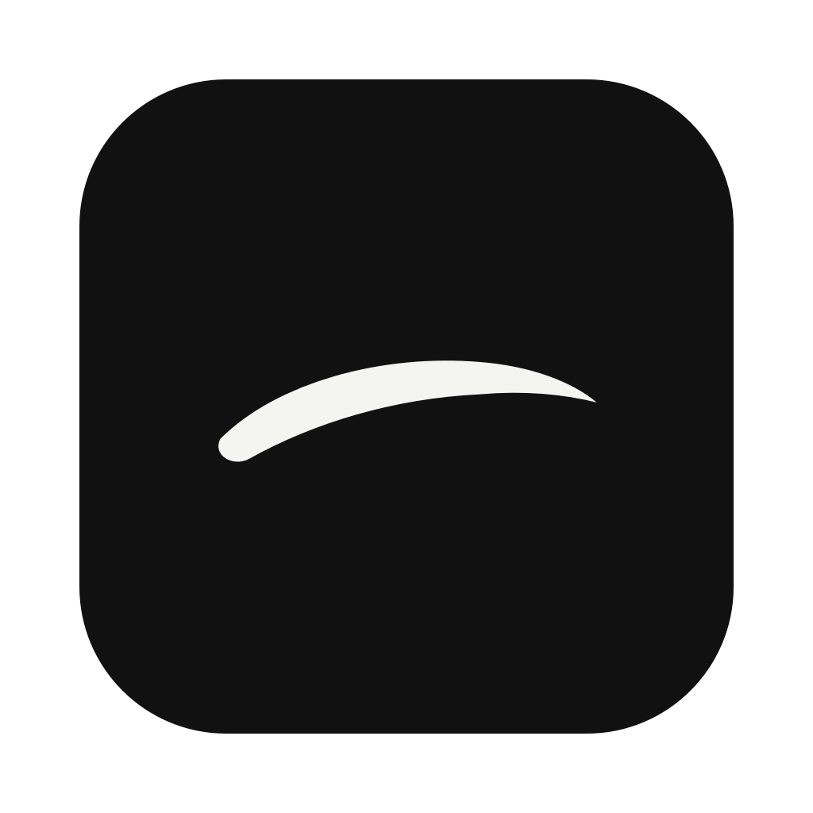
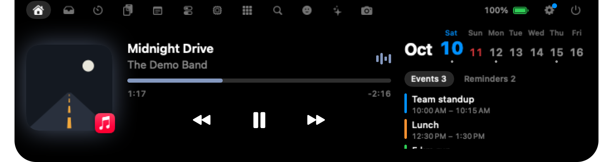

<p align="center"></p>

<h1 align="center">Nunsseop</h1>

<p align="center">
  <b>Your MacBook notch, finally useful.</b><br>
  Music, calls, files, a Spotlight-style launcher, AI usage, agent notifications, your calendar and system HUDs, one hover away.
</p>

<p align="center">
  <a href="https://github.com/namekun/Nunsseop/releases/latest"></a>
  
  <a href="LICENSE"></a>
  
</p>

<p align="center">
  <b>English</b> · <a href="README.ko.md">한국어</a> · <a href="README.ja.md">日本語</a> · <a href="README.zh-Hans.md">简体中文</a> · <a href="README.es.md">Español</a> · <a href="README.de.md">Deutsch</a> · <a href="README.fr.md">Français</a> · <a href="https://namekun.github.io/Nunsseop/">Website</a>
</p>

<p align="center">
  
</p>

*Nunsseop* (눈썹) is Korean for *eyebrow*, the little arch above your screen. It's free, open source, and has no account, subscription or tracking.

## Install in 30 seconds

**[Download Nunsseop.dmg](https://github.com/namekun/Nunsseop/releases/latest/download/Nunsseop.dmg)**, open it and drag Nunsseop to Applications. The app is signed and notarized by Apple, so it opens right away. When an update is out, Install Update in Settings › General › Updates shows what's new, installs it and restarts Nunsseop (copies older than 0.38.0 download the new DMG once more).

Or with [Homebrew](https://brew.sh):

```sh
brew install --cask namekun/tap/nunsseop
```

To update, run `brew update && brew upgrade --cask nunsseop`; when an update is out, Settings › General › Updates copies that command to your clipboard.

Needs macOS 14 Sonoma or later. Runs on Apple silicon Macs (not Intel), including on screens without a notch.

## Your first minute

1. **Hover over the notch.** It opens. Move the pointer away and it tucks itself back.
2. **Play something** in Music, Spotify, YouTube Music or any browser. The notch picks it up, and the collapsed notch shows a tiny artwork and visualizer.
3. **Right-click the notch → Settings** to choose your tabs, their order, the pop-ups you want and the size.

There's no Dock icon. Nunsseop lives in the notch.

On a fresh install the notch also opens by itself after a second and walks you through four short steps: how it opens and closes, the tabs, files and Search, and connecting the agent tools found on this Mac (or "You're all set" when there are none). Skip, Esc or Done ends it, and Settings › General › Show the welcome tour again plays it once more. After an update, it opens once to say what's new in that version, then leaves you alone.

## A look inside

| | |
| :---: | :---: |
| <br>**Search.** A launcher for apps, files, commands, clipboard, emoji and sums, on any shortcut you like. | <br>**AI usage.** Claude Code and Codex limits, no login needed. |
| <br>**Shelf.** Park files in the notch, or drop them on AirDrop. | <br>**Timer.** Countdown, Pomodoro and stopwatch, any length you like. |
| <br>**Tools.** Audio output, mic mute, keep awake, screen recording, color picker and text capture. | <br>**System.** CPU, memory, disk, network and device batteries. |
| <br>**Emoji.** Categories on the left, every emoji searchable, one click to copy. | <br>**HUDs.** Volume, brightness, AirPods battery and more. |
| <br>**Calls.** The call app and how long you've been talking. | <br>**At a glance.** Pick what each side of the closed notch shows. |

## Everything it does

**🎵 Music**
- **Now playing from any app.** Music, Spotify, YouTube Music, and browsers like Safari, Chrome, Arc, Dia and Aside. Artwork, controls and a progress bar you can drag.
- **Synced lyrics** from [LRCLIB](https://lrclib.net), under the title or under the notch while you work.
- **Sneak peek.** When the track changes, the title slides out for a moment.
- **Podcasts and long videos** get 15-second skips and a speed button (1× to 2×), when the player supports them.

**🗂️ Get things done**
- **Shelf.** Drag files onto the notch and back out later, with previews of images, PDFs and videos that grow with the shelf's height. Screenshots and finished downloads can land there automatically. Shake the pointer while dragging files anywhere and a small drop target appears right beside it.
- **Calendar and reminders.** Today in large digits, your week with a dot on busy days, today's events, and reminders you can tick off. Every account added to macOS works (Google, iCloud, Exchange and more), and you choose which calendars show.
- **Upcoming events.** Five minutes before a timed event starts, the notch shows its title and how soon it begins. Events with a Zoom, Google Meet, Teams, Webex, FaceTime, Whereby or Chime link get a green Join button on Home, and clicking the notice joins the meeting.
- **Search that can replace Spotlight.** Apps (even ones outside Applications), files, system commands and settings, clipboard history, emoji (start with `:`) and sums like `12*(3+4)`, ranked by what you open most. Initials work: `vsc` finds Visual Studio Code. Arrow keys pick, Return opens.
- **Your shortcuts.** <kbd>⇧⌘Space</kbd> opens Search by default, or record any combination for it. Settings › General › Shortcuts also has actions that start empty: go to the agent that has waited longest (its terminal comes to the front), open the Agents tab, go to where the last notice came from, and open or close the notch. A combination another action already uses isn't saved, and Nunsseop tells you when macOS or another app already uses it.
- **Timer, clipboard history, notes and an emoji picker.** Clipboard history stays in memory and skips anything a password manager marks as secret. Tracking parameters like `utm_` and `fbclid` are stripped from links you copy.
- **A detail beside the list.** Shelf, Clipboard, Apps, Search and Notifications show the item under the pointer (or picked with ↑ ↓) on the right, with its actions. A click on a row still copies, opens or goes to the source at once.

**💻 Your Mac**
- **System HUDs.** Volume, brightness (including DDC external displays), keyboard backlight, charging, Caps Lock and AirPods battery appear in the notch. It can take over the volume and brightness keys so the system HUD stays away.
- **System stats and batteries.** CPU, memory, disk, network and this Mac's battery as panels, plus your mouse, keyboard and trackpad, with a warning when one runs low.
- **Camera and mic indicator.** A dot on the notch while any app uses them.
- **Tools.** Switch audio output, set each app's volume (experimental, macOS 14.2+), mute the mic, keep the Mac awake, record the screen, eject drives, pick a color from anywhere on screen, and copy the text out of any part of the screen.
- **Weather, downloads, mirror and Dock apps**, one hover away. Weather is a row at the bottom of Home.

**📞 Even when it's closed**
- **Calls.** During a call in Zoom, FaceTime, Teams, Slack, Discord, WhatsApp or Google Meet, the closed notch shows the app and how long you've been talking. It goes by which app uses the microphone, so showing the call of a desktop app needs no permission (in a browser, Meet or Zoom and Teams on the web need Automation for that browser). For Zoom, FaceTime and Meet you can mute the mic from the notch (and turn the camera off in Zoom and Meet), without switching to the call; Zoom and FaceTime need Accessibility for that, and Meet needs *Allow JavaScript from Apple Events* in a Chromium browser.
- **Your pick on each side.** When nothing is playing, show Claude Code or Codex usage left, agents at work, battery, weather or the date.
- **Music and timers.** Tiny artwork and a visualizer while music plays, and the time left while a timer runs. Timers, calls and downloads fit each side to its own content, so a lone icon leaves no gap.
- **Downloads.** How far along a Safari or Chrome download is, in percent, from the same progress the Finder shows on the file. Nothing polls for it.

**🤖 For developers**
- **AI usage.** Claude and Codex limits with reset times, and token use over the last 5 hours and 7 days, counted across Claude Code, Codex, gjc, omo and OpenCode. Read from files those tools already keep on your Mac, so there's nothing to sign in to. A limit turns orange with a "!" from 70%.
- **Claude limits from Claude Code.** In Settings › Services › AI usage, connect Claude Code's status line. Claude Code hands it your 5-hour and weekly limits with every answer, so the AI tab stays current while you work, without Nunsseop asking Anthropic for anything. The status line you already had keeps showing as before, and Disconnect puts it back. If your previous command can't be restored, Settings says so.
- **Live Claude limits (opt-in).** For when you use Claude elsewhere, the AI tab asks once whether to fetch your 5-hour and weekly Claude limits from Anthropic, about once an hour, with the sign-in Claude Code keeps in the Keychain. Claude Code renews that sign-in when it runs, so after a stretch without it the AI tab says to run Claude Code, not to sign in again. Off until you say yes; change it later in Settings › Services. Whichever source is most recent wins, and the plan and per-model bars stay when it doesn't carry them.
- **Limit alerts.** The notch speaks up once when a Claude or Codex 5-hour or weekly limit passes 80% and again at 95%, and says so when a limit that got that far resets. On by default; Settings → Alerts → AI usage.
- **Notifications from agents and terminals.** Claude Code, Codex, Gemini CLI, GitHub Copilot, Antigravity, Cursor and OpenCode hooks, omp, omo and pi extensions, Hermes and Amp plugins, agents in Muxy 2, cmux, herdr and Paseo, and bells from tmux and WezTerm show in the notch. Click a notice to bring its terminal, pane or tab to the front ([setup below](#agent-and-terminal-notifications)).
- **Permission prompts and questions.** Allow, deny or always allow what Claude Code asks to run or edit right from the notch; Always allow appears only when Claude Code suggests a rule of plain keyboard characters (printable ASCII) that fits on the card. The card shows the tool, the folder and every field, and an orange "Unusual characters" chip warns when the text has characters that can pass for English letters or symbols. Codex's approvals for commands, file edits (`apply_patch` lists the files) and MCP tools work the same, with "Answer in terminal" in place of Always allow. OpenCode's permission prompts work the same way, and so do Paseo's tool approvals, with "Answer in Paseo" in place of "Answer in terminal". The approvals of GitHub Copilot, Antigravity (commands and file writes) and Cursor (shell commands and MCP calls) work the same way, with "Answer in Cursor" for Cursor. When a request leaves any doubt about what would run (a Cursor shell command that runs outside its sandbox, say), no card appears and the tool asks in its own prompt. Gemini CLI, Hermes and Amp show sessions and notices but no approvals. Claude Code's questions can be answered too: pick one or several answers, step through several questions, or choose "Answer in terminal" to hand it back; a question whose answers can't be shown faithfully stays in the terminal. Answer in the terminal first and the card goes away. What it asks stays in memory (turn it off in Settings › Alerts).
- **Notifications tab.** The last 30 notices from agents, terminals and your calendar, with a badge for unseen ones; click one to go back where it came from. Off by default (Settings › Notch), and kept in memory only.
- **A brow with moods.** The eyebrow shows how your agents are doing: raised with its tail up while one waits for you, low and level while they work. When an agent finishes its turn the eyebrow hops twice and the notch says which one is done (unless its terminal is already in front; Settings › Alerts). It droops when a Claude or Codex limit runs low and lifts again when the limit resets. Without a notch the app's own eyebrow wears the mood; beside a camera the agents count shows a small one, and agent and limit notices use it as their icon. Reduce Motion keeps it still.
- **Agents at work.** A closed-notch item that shows how many coding agents wait for you (a raised eyebrow, the count in yellow), or, when none wait, how many are working (a low, level eyebrow, the count in green). It follows Claude Code, Codex, Gemini CLI, OpenCode, GitHub Copilot, Antigravity, Cursor, Hermes, Amp, omp, omo and pi through their hooks, plugins or extensions (connect them in Settings › Alerts; Codex asks you to trust the hooks the next time it starts), and gjc, herdr, Muxy 2 and Paseo on their own, background sessions started with `claude --bg` included. When Claude Code ends a turn while subagents or background shell commands still run, the session keeps counting as working for up to two hours, with a "Background · N tasks" chip in the Agents tab.
- **Agents tab.** One line for each coding agent session at work or waiting for you: Claude Code, Codex, Gemini CLI, OpenCode, GitHub Copilot, Antigravity, Cursor, Hermes, Amp, omp, omo, pi, gjc, Paseo, and whatever runs in herdr or Muxy 2. The state differs in shape as well as color: a filled orange dot when it waits for you, a turning green arc while it works, an empty ring when idle. Then come the title (Claude Code's `/rename` name or its own title, Codex's thread name), the folder, tool and model, a chip when the permission mode isn't the default, a small context meter with the token count, and how long ago the state began. Every row has **Go to terminal** (**Open in Paseo** on a Paseo row) and **Message** buttons; a dashed one can't act now, and its tooltip says why. A session waiting for you unfolds with "Answer in terminal". The bottom line sums up the states ("1 waiting · 3 working · 1 idle"). Keys: ↑↓ select, ↵ goes to the terminal, ⌘M opens the message field; double-clicking a row goes to its terminal too. Open sessions you used in the last 3 hours show dimmed as Idle (the closed notch doesn't count them). When no session is open, **Recent** lists up to 5 conversations from the last week: click one (or press ↵) to resume it in the terminal chosen in Settings › Alerts (`claude --resume`, `codex resume`, or the tool's own option). It reads the folder, model, token count, permission mode, session name and last prompt from the tools' own session files on your Mac. Under a session at work, or one done with its turn, is its last step: the file it read or edited, the command it ran, the question it asked. An edit shows its +N −M and **Show diff**, which shows the changed lines in place of the list (← → for the turn's other changes, Esc goes back). While the tab shows a session at work, its session file is looked at every 2 seconds.
- **Message a session, drop files on it.** Press a row's Message button (or ⌘M): the bottom line becomes a "To <session>" field, Return types the text into the session and presses Return there, and Esc cancels. Drop files from the Shelf or Finder on a row and their paths are typed in without Return; when dragging from the Shelf, hold the pointer over the Agents tab button to switch to it. This works for sessions in Ghostty, Terminal, iTerm2, WezTerm, kitty, cmux, herdr, Muxy 2 and Orca (Terminal takes messages but not files), and for Paseo agents that aren't working, messages only (table below, "What works where"). Nothing is sent while a permission prompt or question may be open, to a session inside tmux, zellij or screen, or when Nunsseop can't confirm which terminal the session is in.
- **Weekly recap.** The first time the notch opens each week (Monday or later), a card "What your brow saw last week" shows what your agents did: their working time against the week before, sessions per tool, lines changed (+/−) and files, tokens per tool, the project they worked on most with its share of the time, the longest session, and the busiest day as bars. It's added up on this Mac from the session files of Claude Code, Codex, omo, gjc, omp, pi and OpenCode and sent nowhere; sessions a program started with the Agent SDK are left out. **Save image** writes a 1080×1920 PNG to Downloads with the project names hidden. Reopen it any time from the AI tab ("Last week"). On by default; turn it off in Settings › Alerts › AI usage.

**🧩 Make it yours**
- Every tab sits in one row in the header, and the current tab shows its name in a capsule. On a display with a notch the row sits left of the camera and scrolls when it doesn't fit. Home, Timer, Tools, System and AI usage are panels with large figures and thin bars. Settings has a sidebar, and the tab list in the Notch pane is a two-column grid you can drag to reorder.
- Pick your tabs and drag them into order, whether the header shows the date, what the collapsed notch shows, and which pop-ups you get. **Anything you turn off stops running.**
- On macOS 26 the expanded notch and its cards use Liquid Glass, so what's behind shows through softly. You can set how dark the glass is, all the way to 100% for a solid black notch, or switch the glass off.
- On displays without a notch, the closed notch is a small pill in the menu bar, in glass if you like, with the eyebrow, a white brush stroke, on it. The eyebrow lifts when the pointer is over it. After it sits unused (3 to 60 seconds, or never) it lowers like a closing eye and fades out, and it comes back when the pointer reaches it; rest there for half a second and it opens, attached to the top edge. There, HUDs, notices, lyrics and the sneak peek are one line, with the symbol right beside the level bar, percent or text. The idle values grow the pill just enough for each one, right beside the eyebrow, and the eyebrow stays over the camera.
- Choose the display, size and hover delay, launch at login, and hide the notch while the lid is closed. On automatic, the closed notch follows the pointer to another display, or stays put if you turn that off. Mission Control hides it.
- Swipe down to open, up to close, sideways on Home to skip tracks.
- Speaks English, 한국어, 日本語, 简体中文, Español, Deutsch and Français, following your Mac.

## FAQ

<details>
<summary><b>macOS says Nunsseop can't be opened.</b></summary>

Since 0.37.0 the app is signed and notarized by Apple and opens like any other. A copy older than that wasn't: [download the latest DMG](https://github.com/namekun/Nunsseop/releases/latest/download/Nunsseop.dmg), or update with Homebrew (`brew update && brew upgrade --cask nunsseop`).
</details>

<details>
<summary><b>Does it work on a MacBook Pro with the Dynamic Island?</b></summary>

It should, but we haven't had one to try yet. The system draws in the Dynamic Island, so the eyebrow rests beside it instead of over it, and hovering it opens Nunsseop as usual. If you have one, run `/Applications/Nunsseop.app/Contents/MacOS/Nunsseop --print-screen-info` and [open an issue](https://github.com/namekun/Nunsseop/issues) with what it prints; that's how we'll get it right.
</details>

<details>
<summary><b>Nothing shows up when I play music.</b></summary>

Nunsseop shows whatever macOS lists as Now Playing, so the player has to appear in Control Center. Most apps and browsers do. See [how now playing works](#how-now-playing-works) for the fallback.
</details>

<details>
<summary><b>Can Search replace Spotlight?</b></summary>

Yes. Open Settings → General, click the shortcut and press <kbd>⌘Space</kbd>. Nunsseop will point out that Spotlight uses it and open Keyboard Shortcuts, where you untick *Show Spotlight search*. Search also opens when its tab is hidden.
</details>

<details>
<summary><b>There are too many tabs.</b></summary>

Right-click the notch → Settings → Notch, and switch off what you don't need. Turned-off features stop running entirely.
</details>

<details>
<summary><b>My Mac has no notch.</b></summary>

On a display without a notch, such as an external monitor with the lid closed, the closed notch is a small pill floating in the menu bar, with the eyebrow, a white brush stroke, on it. The eyebrow lifts when the pointer is over it, and opening it attaches the notch to the top edge at the usual size. HUDs, notices, lyrics and the sneak peek show on one line instead of around a camera. When unused, the eyebrow lowers like a closing eye and the pill fades out; turn that off or change the delay in Settings. With several displays, the closed notch moves to the display the pointer is on once it has finished closing, and HUDs, approvals and the sneak peek show up there too; pick one display in Settings to keep it in place.
</details>

<details>
<summary><b>Why does AI usage show old Claude limits?</b></summary>

By default, Claude's 5-hour and weekly percentages come from caches other tools write: the [oh-my-claudecode](https://github.com/Yeachan-Heo/oh-my-claudecode) HUD while you use Claude Code in a terminal, or gjc. The card shows when they were last updated. For limits that stay current, connect Claude Code's status line in Settings › Services › AI usage: Claude Code hands it your limits with every answer, and your own status line keeps working. If you use Claude elsewhere, turn on live Claude limits in the AI tab or Settings › Services instead. The most recent source wins, and the plan and per-model bars stay when it doesn't carry them. Token totals are always live.
</details>

<details>
<summary><b>Volume keys stopped showing Nunsseop's HUD after an update.</b></summary>

Versions before 0.8.3 were signed in a way that made macOS forget the Accessibility permission on every update. Since 0.8.3 it's kept. If you came from an older version, remove Nunsseop from System Settings → Privacy & Security → Accessibility once and allow it again; it takes effect without a restart.
</details>

## Agent and terminal notifications

Nunsseop listens on `127.0.0.1:47750` for notifications from tools on your Mac. Requests must carry the secret token stored in `~/Library/Application Support/Nunsseop/notify-token`.

Open Settings → Alerts and press **Connect** next to Claude Code, Codex, Gemini CLI, GitHub Copilot, Antigravity, Cursor, OpenCode, Hermes, Amp, omp, omo or pi. Only tools you have used on this Mac are listed. Nunsseop changes that tool's settings file (`~/.claude/settings.json`, `~/.codex/config.toml`, `~/.codex/hooks.json`, `~/.gemini/settings.json`) or adds a plugin to `~/.config/opencode/plugins` or a small extension to `~/.omp/agent/extensions` (`~/.omo` and `~/.pi` likewise), and keeps the old file with a `.nunsseop-backup` extension. Before it writes anything, a sheet shows how the file will change (added lines in green, removed ones in red, unchanged stretches folded away) and which backup is kept; **Cancel** writes nothing. Where the file is shared with other tools (Claude Code, Codex, Gemini CLI, Antigravity and Cursor), the hooks you already had stay as they are, and **Disconnect** removes only Nunsseop's. Codex allows only one `notify` command, so an existing one keeps running after Nunsseop's. Its hooks for the agents count go into `~/.codex/hooks.json` beside other tools' hooks, and Codex asks you to trust them the next time it starts ("Review hooks" lets you trust only Nunsseop's; "Trust all and continue" trusts every tool's new hooks); until then it doesn't run them, and it asks again after an update that changes their text. The hook that lets you answer approvals in the notch is trusted the same way; if you connected before, Codex asks once more, so review it in `/hooks`. **Disconnect** undoes it. Sessions started afterwards send their notifications to the notch. gjc needs no connecting: its sessions are read from its own files while the agents count or the Agents tab is showing.

GitHub Copilot gets a hook file of its own, `~/.copilot/hooks/nunsseop.json`; Antigravity (the `agy` command line) gets one entry in `~/.gemini/config/hooks.json`, and Cursor entries in `~/.cursor/hooks.json`, beside other tools' hooks. Hermes and Amp get a plugin of Nunsseop's (`~/.hermes/plugins/nunsseop`, `~/.config/amp/plugins/nunsseop.ts`). Hermes loads a plugin only once you run `hermes plugins enable nunsseop` in a terminal; Settings shows that command and whether Hermes has it on. Amp's plugin API is experimental, so an Amp update may stop it from working. Once connected, Gemini CLI, GitHub Copilot, Antigravity, Cursor, Hermes and Amp report their sessions to the agents count and the Agents tab and send a notice when a turn finishes. Approvals from GitHub Copilot, Antigravity and Cursor show in the notch only while "Answer permission prompts and questions in the notch" is on in Settings › Alerts.

To set up Claude Code by hand, press **Copy Claude Code hook command** and add it to `~/.claude/settings.json`:

```json
{
  "hooks": {
    "Notification": [
      { "hooks": [{ "type": "command", "command": "<paste the copied command here>" }] }
    ]
  }
}
```

Terminals and agent apps need no hook:

- **Muxy 2:** the agents Muxy itself detects, read with `muxy activity list` while Muxy runs. They show as notices (not while Muxy is in front), and the sessions only Muxy knows show in the Agents tab while they work or wait. Muxy 1, which kept a notifications file and a socket, isn't supported.
- **cmux:** its own notifications, read through the cmux command inside the app and not shown while it's in front.
- **herdr:** agents that finish or wait for input, in every session, read from herdr's socket.
- **Paseo:** agents that finish or fail, read from Paseo's own record files, so they show even without its daemon. Approval cards and its events need the daemon on this Mac, which must run without a password and which Nunsseop never starts.
- **tmux:** bells from any window. Nunsseop adds a hook to the running tmux server only; `tmux.conf` isn't changed.
- **WezTerm:** bells, through lines you copy from Settings › Alerts and paste into `~/.wezterm.lua`.

Each has a toggle under Settings › Alerts (WezTerm has a button that copies its config lines instead), shown only when the tool is installed. Tools already connected through their own hook aren't shown twice. Orca has no notification source of its own: its sessions show up only through the hooks and extensions connected above (Claude Code, Codex, OpenCode, pi and the like), which send its pane id.

Any script can send one too:

```sh
# notify-auth holds the Authorization header, so the token never shows in the process list.
curl -X POST http://127.0.0.1:47750/notify \
  -H @"$HOME/Library/Application Support/Nunsseop/notify-auth" \
  -d '{"title": "Build", "message": "Finished in 42 s"}'
```

### What works where

A row's Go to terminal and Message buttons, and file drops, work where Nunsseop can be sure which terminal the session is in: it checks that the session's process really runs there. Text goes in through the terminal's own input API, never as simulated keystrokes. Where a message or a drop can't work, the button is dashed and its tooltip says why (tmux, zellij or screen in between; a prompt waiting for an answer; several Ghostty tabs in the same folder; and so on); Go to terminal still brings the terminal app forward then.

| Terminal | Go to its tab or pane | Message | Drop files | Resume from Recent |
| --- | :---: | :---: | :---: | :---: |
| Ghostty | ✓¹ | ✓¹ | ✓¹ | ✓ |
| Terminal | ✓ | ✓ | — | ✓ |
| iTerm2 | ✓ | ✓ | ✓ | ✓ |
| WezTerm | ✓ | ✓ | ✓ | ✓ |
| kitty | ✓ | ✓ | ✓ | ✓ |
| cmux | ✓ | ✓ | ✓ | ✓ |
| herdr | ✓ | ✓ | ✓ | — |
| Muxy 2 | ✓ | ✓ | ✓ | ✓ |
| Orca | ✓ | ✓ | ✓ | ✓ |
| Paseo | ✓ | ✓ | — | ✓ |

¹ Claude Code sessions only.

- **Ghostty, Terminal and iTerm2** are driven with AppleScript, so macOS asks once for each whether Nunsseop may control it (System Settings › Privacy & Security › Automation). Ghostty tells no shell which tab it is, so Nunsseop picks the tab by the session's folder and the title Claude Code gives it. Going to the tab, messages and drops therefore work for Claude Code sessions only, and when it isn't certain which tab is the session's, it sends nothing. Terminal can only take text that it runs, so it takes messages but refuses dropped files.
- **WezTerm and kitty** are driven through their command-line tools (`wezterm cli`, `kitty @`). kitty needs remote control turned on, with a socket it listens on.
- **Muxy 2:** to go to a session's exact pane and to resume in a new tab, load Nunsseop's small bridge extension once. In Muxy, open Settings › Extensions › Load Unpacked…, pick `~/Library/Application Support/Nunsseop/muxy-bridge` (Settings › Alerts › Show extension in Finder opens it) and turn the extension on. Without it, a click selects the session's project. Sessions that only Muxy lists (no hook) can be gone to but not typed into.
- **Orca:** through the `orca` command line; recent conversations resume in a new tab of the worktree that holds them while Orca has a window.
- **Paseo:** messages go through `paseo send` and only to agents that aren't working (finished ones and those waiting for your turn included; it would interrupt a working one); a click opens the agent in Paseo (the first cell of its row), and archived agents come back from Recent.
- **Resume** happens in the terminal chosen in Settings › Alerts › Resume conversations in; Terminal is the fallback. Ghostty, iTerm2 and cmux are offered when installed and are started if not running; WezTerm when its command-line tool exists; kitty only while a socket one of its sessions reported still exists; Orca only while it runs with a window, and only for folders Orca knows as a worktree (otherwise the next terminal takes it); Muxy only while its bridge runs. Ghostty and iTerm2 open a new tab through Automation (Ghostty a new window if that's refused); cmux opens a new workspace, not a tab. Paseo's Recent entries ignore the setting and open in Paseo.

## Permissions

Nunsseop asks for most permissions only when you first use the feature that needs them. The exception is the folder it watches for screenshots (the Desktop by default, or the folder set for screenshots) and Downloads: macOS may ask about them when Nunsseop first starts.

| Feature | Permission | When it is asked |
| --- | --- | --- |
| Calendar | Calendars | When you press *Allow Access* on the Home tab |
| Reminders | Reminders | When you press *Allow Reminders* on the Home tab |
| Mirror | Camera | When you press *Allow Camera* on the Mirror tab |
| Screen recording, and copying text from other apps' windows | Screen Recording | The first time you start a recording or capture text |
| Recording with sound | Microphone | The first time you record with microphone audio on |
| Taking over volume, brightness and keyboard backlight keys | Accessibility | When you turn the option on in Settings |
| Fallback now playing for Music, Spotify and browsers | Automation | Only if the MediaRemote helper is unavailable |
| Showing Google Meet, Zoom and Teams calls in a browser, and Meet's mute and camera buttons | Automation (that browser) | When a browser first uses the microphone |
| Adding new screenshots to the shelf, download alerts | Desktop and Downloads folders | macOS may ask when Nunsseop first starts (it watches the screenshot folder, the Desktop by default, and Downloads) |
| Per-app volume | System audio recording | The first time you turn an app down in the Tools tab |
| Mute button for Zoom and FaceTime calls, camera button for Zoom | Accessibility | Never asked for by itself: the buttons appear once Nunsseop is allowed in Accessibility (for example through the volume key option above) |
| Typing messages into agent sessions, going to a session's tab, resuming in a new tab (iTerm2 and Ghostty only) | Automation (Terminal, iTerm2, Ghostty) | The first time you do one in that app; for Ghostty also when the Agents tab first lists a session running in it |
| Launch at login | Login Items | When you turn it on in Settings |

## Privacy

Nunsseop doesn't collect or send personal data. It goes online only to:

- check `api.github.com` for a newer release once a day (can be turned off), and, when you install an update in a copy from the DMG, fetch the `appcast.xml` and DMG of the latest release from GitHub;
- look up synced lyrics on `lrclib.net` (can be turned off);
- fetch weather from `open-meteo.com` for the city you enter (off until you enter one), asking Apple's geocoder for the city's location when Open-Meteo can't find it;
- download artwork over HTTPS from known music services, only when the MediaRemote helper is unavailable;
- ask `api.anthropic.com` for your Claude limits about once an hour, using Claude Code's sign-in from the Keychain, only if you turn live Claude limits on.

Everything else stays on your Mac. The notification server only accepts connections from this Mac. AI usage is read from local files, including the limits the Claude Code status line keeps on this Mac, unless you turn on live Claude limits. Notices in the Notifications tab are kept in memory only. Recordings are saved next to your screenshots. The camera preview runs only while the Mirror tab is open and is never recorded. Clipboard history is cleared when Nunsseop quits.

## How now playing works

Since macOS 15.4, the private MediaRemote framework only answers processes signed by Apple. Nunsseop ships a small helper library (`Sources/NowPlayingHelper`) that runs inside the system's `/usr/bin/perl`, reads the Now Playing state, sends play, pause, skip and seek commands, and streams JSON lines back to the app.

This relies on private API, so a future macOS update may break it. If it does, Nunsseop falls back to AppleScript for Music and Spotify and to reading media tabs in browsers. That fallback needs *Allow JavaScript from Apple Events* turned on in each browser. Dia has no menu item for it, so Nunsseop offers to restart it with `--enable-applescript-javascript`.

## Build from source

```sh
git clone https://github.com/namekun/Nunsseop.git
cd Nunsseop
./scripts/bundle.sh release      # build/Nunsseop.app
./scripts/make-dmg.sh            # build/Nunsseop-<version>.dmg
```

You need the Xcode command line tools with Swift 5.10 or later. `scripts/bundle.sh` builds the Swift package and wraps it in an ad-hoc signed app bundle.

## License

[MIT](LICENSE). Issues and pull requests are welcome.
